# Original v1 screenshot walkthrough

[Back to the main README](../../README.md) · [Open the public synthetic demo](https://ai-support-architect.lovable.app/)

These **11 original PNG screenshots (1313 × 1197 each)** were supplied by the project owner on October 11, 2026. Each image is presented separately, at its original aspect ratio. None has been generated, retouched, stitched, overlaid, cropped, stretched or rewritten. When a report section spans several captures, the subsequent screenshot is labeled as a continuation instead of being blended with its neighbor.

[Overview](#1-overview--synthetic-portfolio) · [Inventory](#2-workflow-inventory--15-assessments) · [Assessment](#3-password-reset--assessment) · [Blueprint](#4-password-reset--implementation-blueprint) · [Roadmap](#5-implementation-roadmap) · [Report](#6-executive-report--overview)

---

## 1. Overview — synthetic portfolio

Synthetic scenario summary, operating-model distribution, top candidates and clearly unverified controls.

[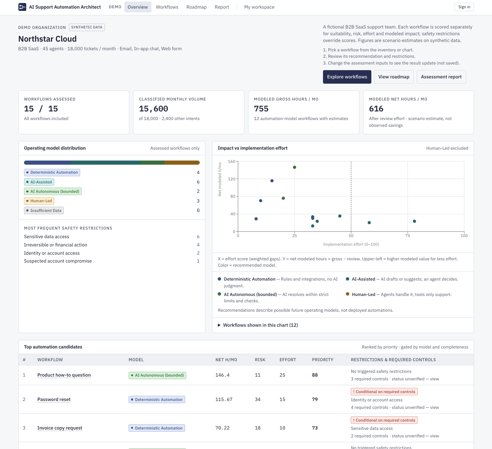](v1-01-overview.png)

[Open this original image at full resolution](v1-01-overview.png)

---

## 2. Workflow inventory — 15 assessments

An overview of the fifteen workflows and their deterministic recommendations.

[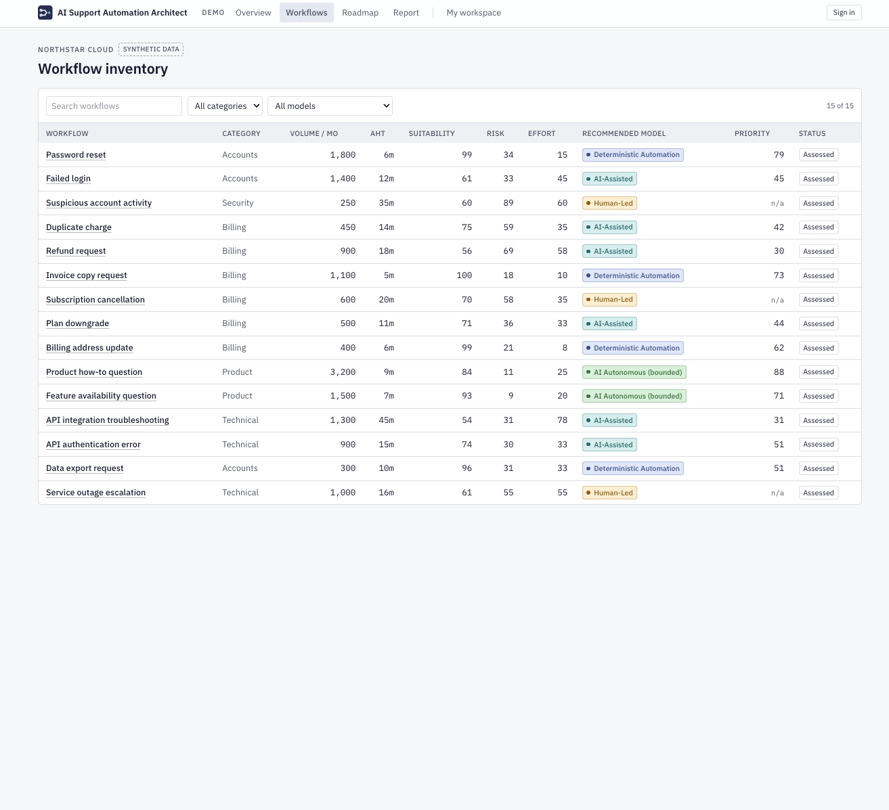](v1-02-workflow-inventory.png)

[Open this original image at full resolution](v1-02-workflow-inventory.png)

---

## 3. Password reset — assessment

Safety-restricted deterministic recommendation, factor scores and declared recovery-control caveat.

[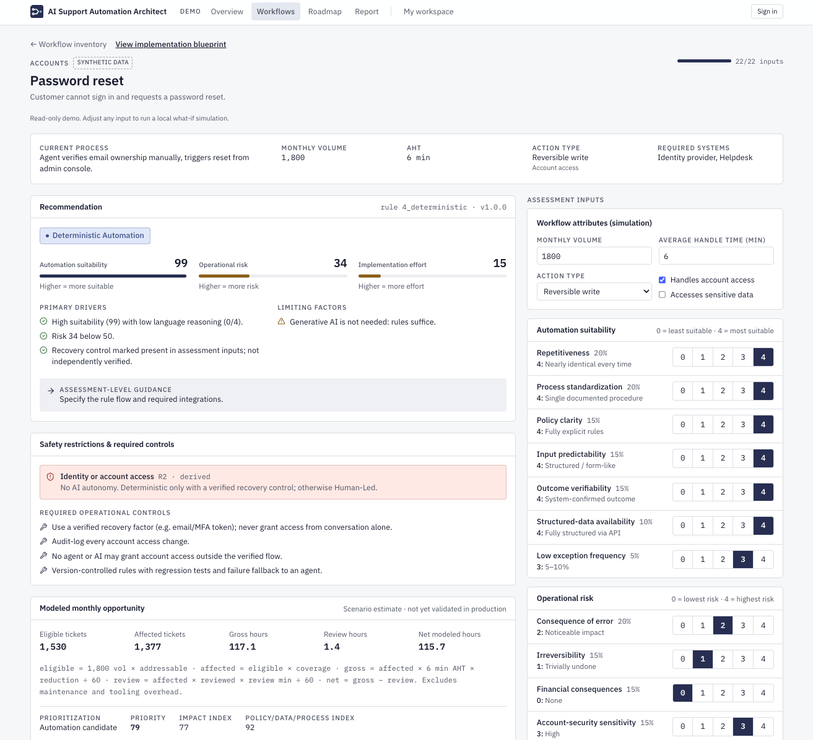](v1-03-password-reset-assessment.png)

[Open this original image at full resolution](v1-03-password-reset-assessment.png)

---

## 4. Password reset — implementation blueprint

Future-state design, mandatory security controls and responsibility boundaries.

[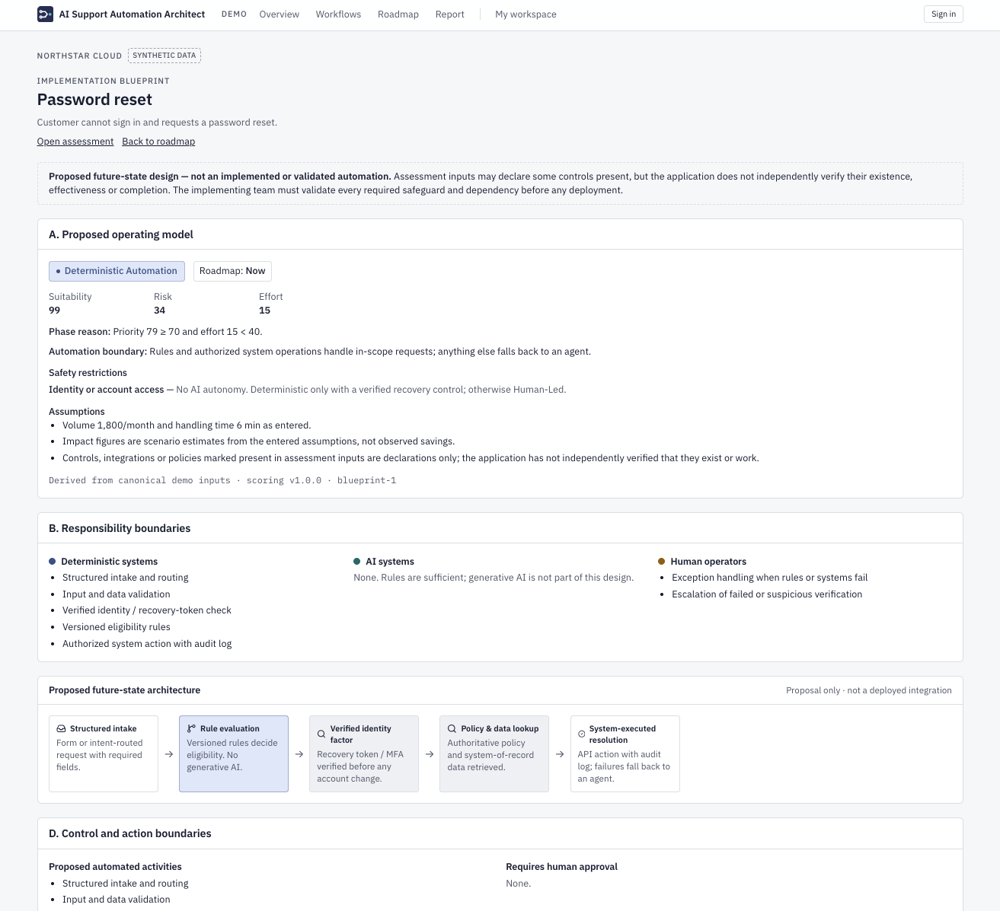](v1-04-password-reset-blueprint.png)

[Open this original image at full resolution](v1-04-password-reset-blueprint.png)

---

## 5. Implementation roadmap

Now / Next / Later recommendations and phase-appropriate immediate actions.

[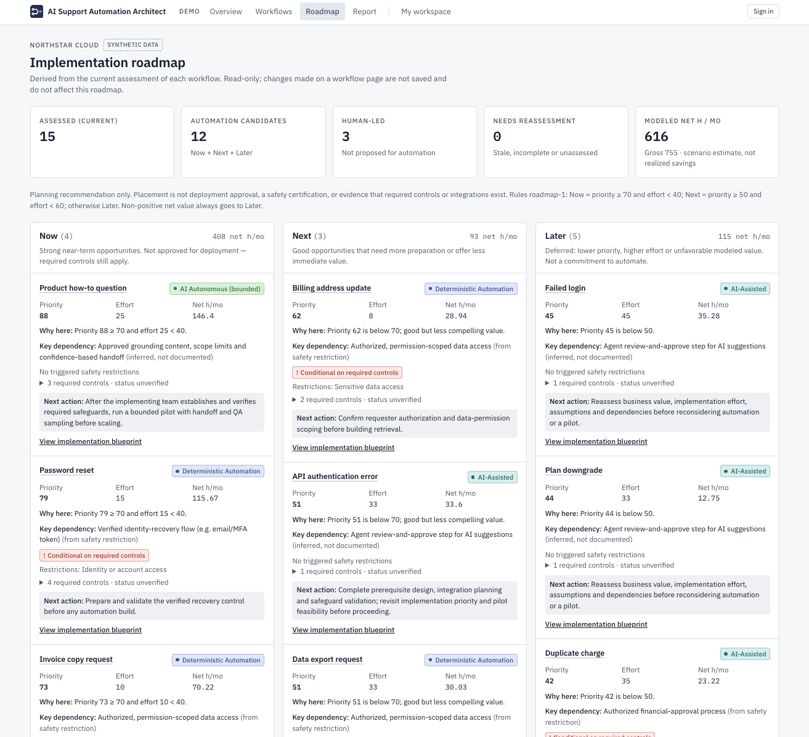](v1-05-implementation-roadmap.png)

[Open this original image at full resolution](v1-05-implementation-roadmap.png)

---

## 6. Executive Report — overview

Report introduction, executive summary and scope of coverage.

[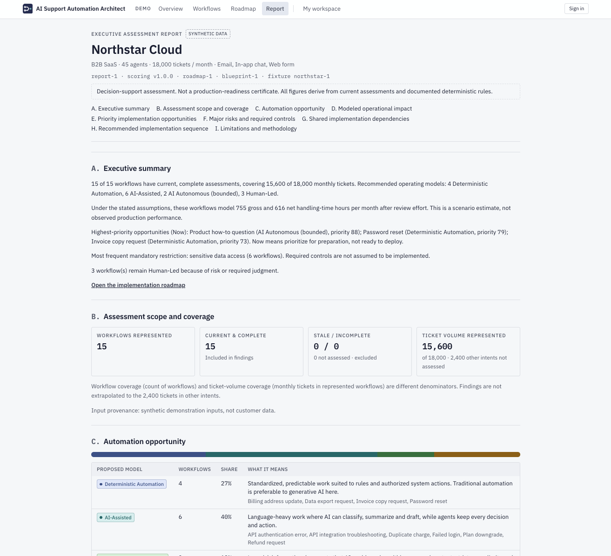](v1-06-report-summary.png)

[Open this original image at full resolution](v1-06-report-summary.png)

---

## 7. Executive Report — impact and Now priorities

Original browser viewport including modeled impact and the **Now** part of Section E; not a reconstructed whole-section screenshot.

[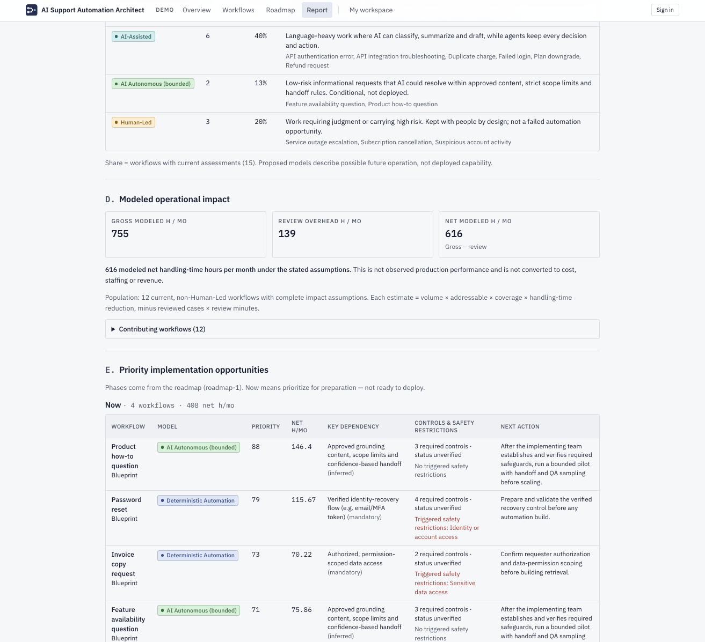](v1-07-report-impact-and-now.png)

[Open this original image at full resolution](v1-07-report-impact-and-now.png)

---

## 8. Executive Report — Next and Later priorities

Next browser viewport with the remaining Section E tables and Human-Led treatment, shown independently from the preceding capture.

[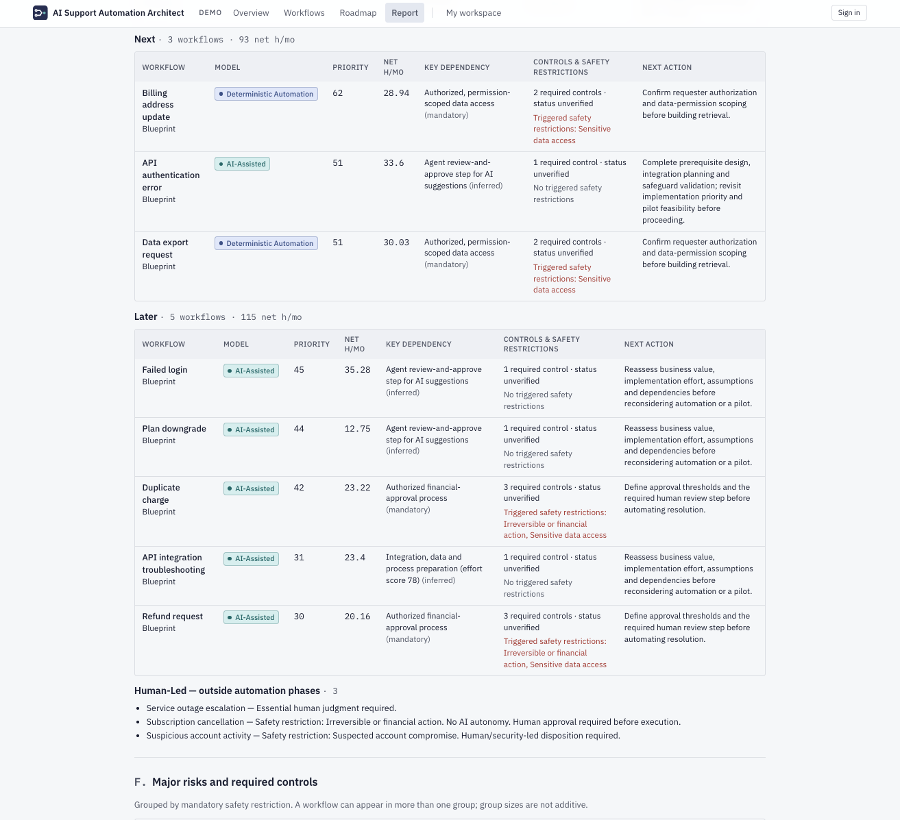](v1-08-report-next-and-later.png)

[Open this original image at full resolution](v1-08-report-next-and-later.png)

---

## 9. Executive Report — safety and dependencies

Major risks and required operational controls with the beginning of shared dependencies.

[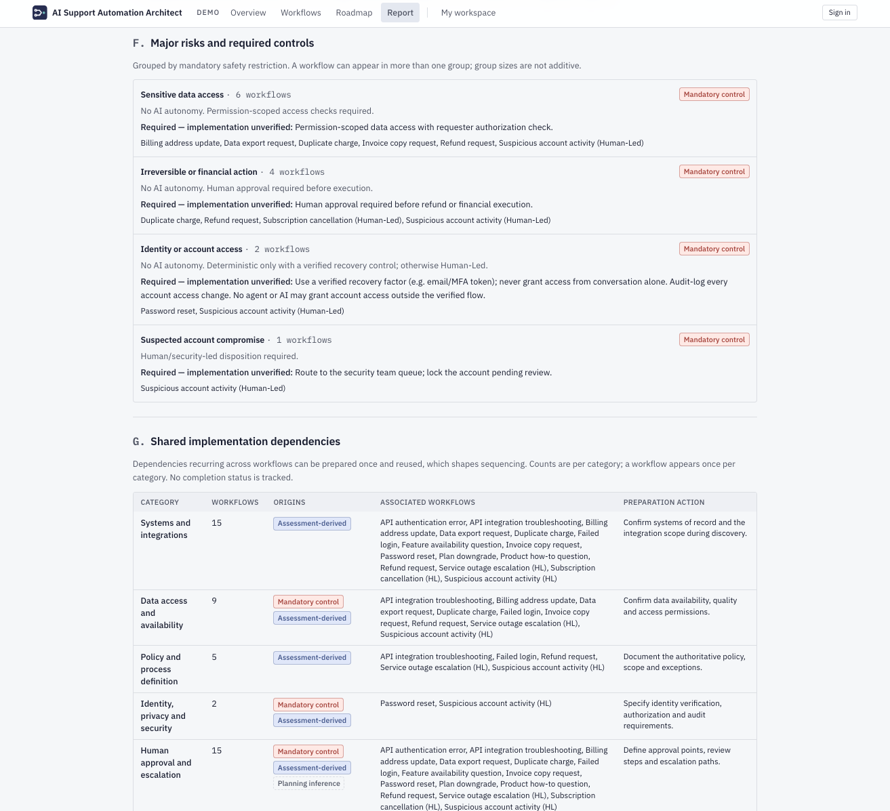](v1-09-report-controls-and-dependencies.png)

[Open this original image at full resolution](v1-09-report-controls-and-dependencies.png)

---

## 10. Executive Report — Define and Prepare

Shared dependencies and the preparation steps in the recommended implementation sequence.

[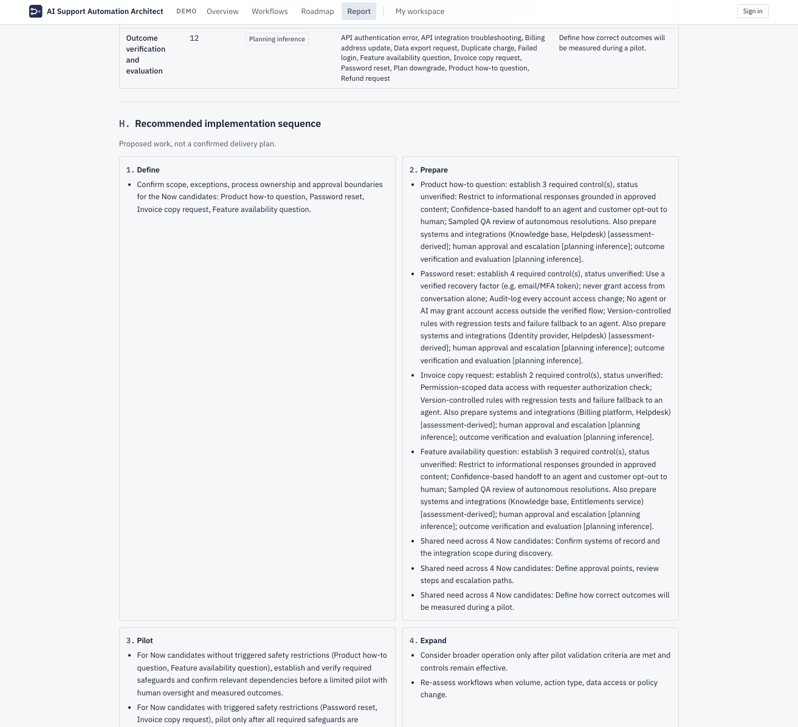](v1-10-report-implementation-sequence.png)

[Open this original image at full resolution](v1-10-report-implementation-sequence.png)

---

## 11. Executive Report — Pilot, Expand and limitations

Control-gated pilot guidance and limits of the deterministic assessment method.

[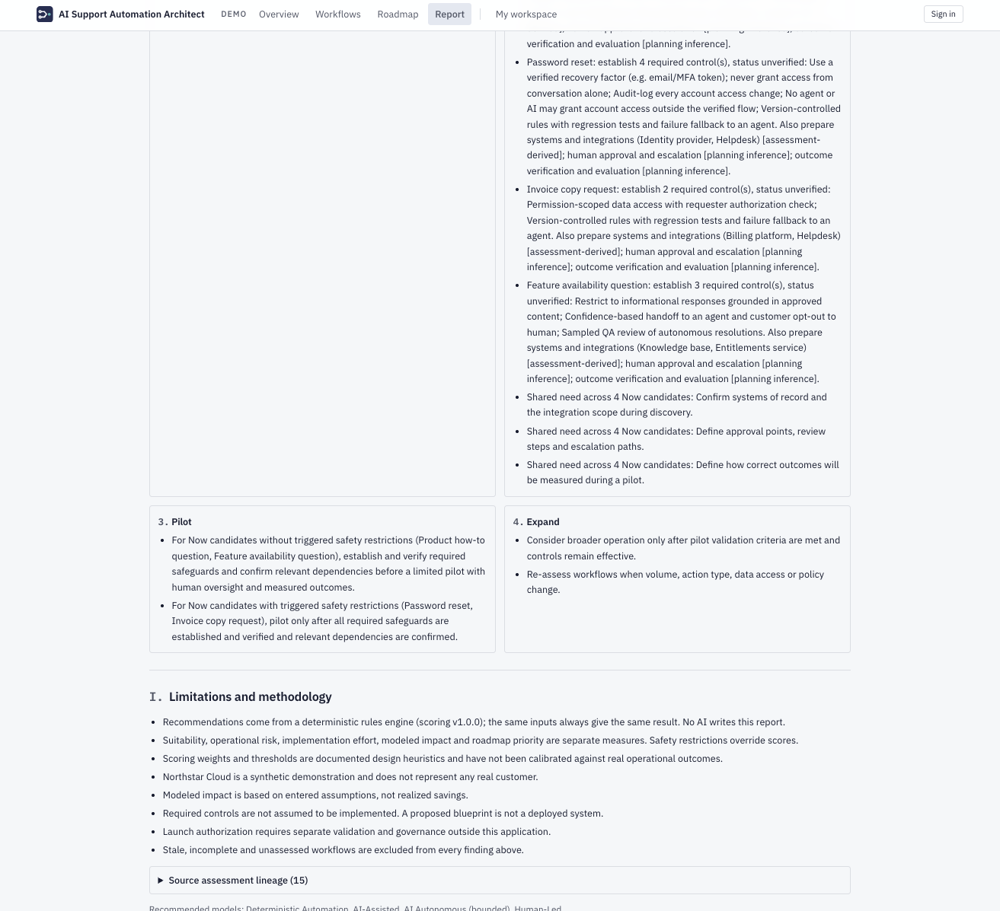](v1-11-report-pilot-and-limitations.png)

[Open this original image at full resolution](v1-11-report-pilot-and-limitations.png)

---

**Provenance:** This is a synthetic demo. These captures do not establish production automation, realized savings, independently verified safeguards or security certification.

[SHA-256 integrity references for all original PNGs](SOURCE_SHA256.txt).
